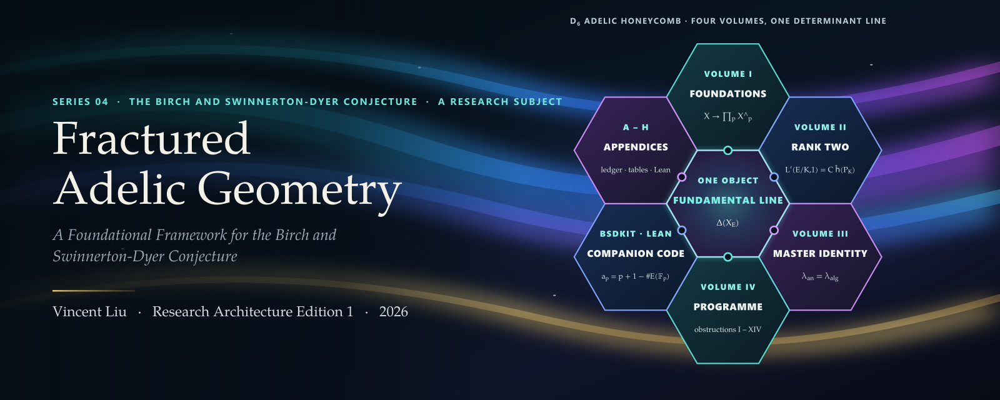
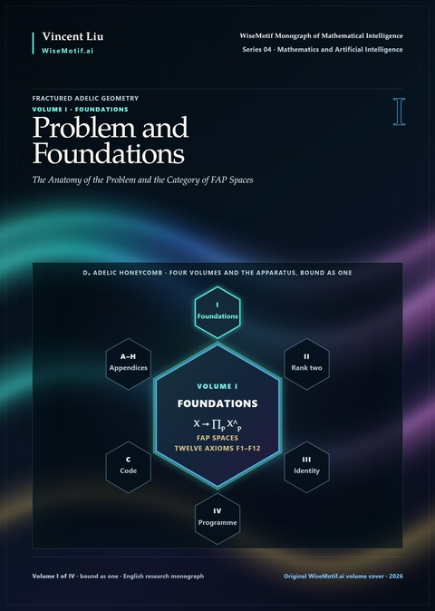
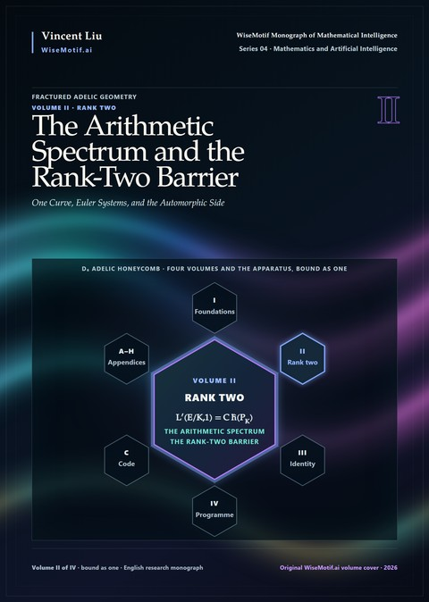
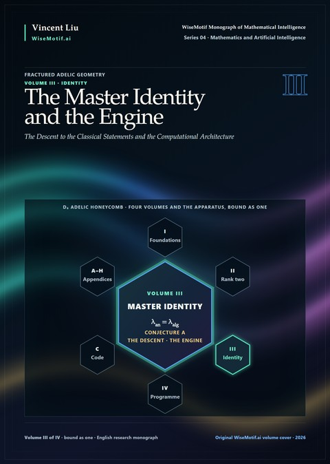
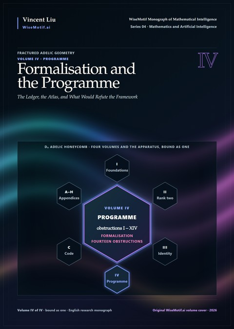
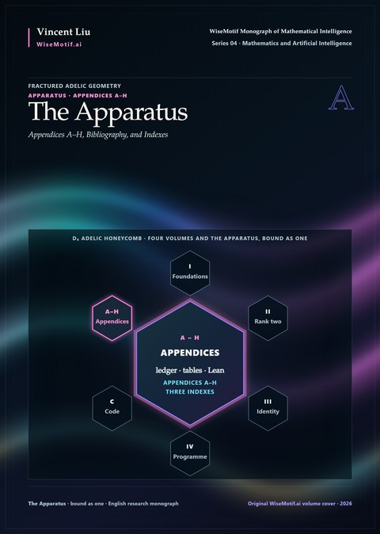
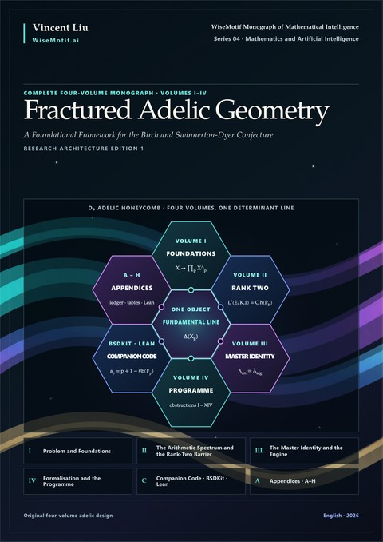

<p align="center">
  <a href="https://doi.org/10.5281/zenodo.23585887"></a>
</p>

<p align="center">
  <a href="https://doi.org/10.5281/zenodo.23585887"></a>
  <a href="https://creativecommons.org/licenses/by-nc-nd/4.0/"></a>
  <a href="https://github.com/AlienMuse/fractured-adelic-geometry/releases/tag/v1.0.0"></a>
  
  
  
  <a href="VERIFY.md"></a>
  <a href="VERIFY.md"></a>
</p>

<p align="center">
  <b><a href="https://github.com/AlienMuse/fractured-adelic-geometry/releases/download/v1.0.0/Fractured-Adelic-Geometry-v1.0.0-Preview.pdf">Read the preview</a></b> (73 pages, 72.0 MB) ·
  <a href="#download">Download</a> ·
  <a href="#the-four-volumes">Volumes</a> ·
  <a href="#citation">Cite</a> ·
  <a href="VERIFY.md">Verify</a> ·
  <a href="README.zh-CN.md">中文</a>
</p>

<br>

> *A hard problem is not attacked where it stands; a theory is raised around it until the problem becomes natural
> and gives way.*
> <br>— Series Note

**Fractured Adelic Geometry** — *A Foundational Framework for the Birch and Swinnerton-Dyer Conjecture* — is a
monograph in four volumes bound as one. It is the fourth work in the WiseMotif Monograph of Mathematical
Intelligence and belongs to the Grothendieckian Programme as a self-contained system: one of the Programme's research
subjects, a problem on which its method of recursive mathematical discovery is carried through in full. A structure
is proposed; it is tested against the cases in which the answer is known; what survives is abstracted and the
question is posed again, in the manner of Grothendieck's rising sea.

The problem is the conjecture of Birch and Swinnerton-Dyer, and the question is **why sixty years of work have
produced theorems only in analytic rank at most one, and what kind of object would make the conjecture a single
statement instead of a comparison between two unrelated quantities.**

**The Birch and Swinnerton-Dyer conjecture remains open. This work does not prove it, proves no case of it that was
not already known, and proves the finiteness of the Tate–Shafarevich group for no curve.** What it offers is the state
of the question after the method has been applied without concession: what the framework would deliver, what it
would need, and where each route to it stops.

<table>
  <tr>
    <td align="center"><b>4</b><br><sub>volumes,<br>bound as one</sub></td>
    <td align="center"><b>10 · 56</b><br><sub>parts ·<br>chapters</sub></td>
    <td align="center"><b>571</b><br><sub>pages</sub></td>
    <td align="center"><b>12</b><br><sub>axioms<br>F1–F12</sub></td>
    <td align="center"><b>12 · 14</b><br><sub>conjectures ·<br>obstructions</sub></td>
    <td align="center"><b>1</b><br><sub>Master Identity,<br>conjectural</sub></td>
    <td align="center"><b>30 · 364</b><br><sub>vector figures ·<br>references</sub></td>
  </tr>
</table>

## The idea: one object with two descriptions

Every proved case of the conjecture crosses from the analytic side to the arithmetic side by a bridge — Heegner
points, Kolyvagin systems, Kato's Euler system — that carries one class in one direction, and the bridges stop at
analytic rank one. The thesis of the book is that **the bridges are a symptom, not a solution.** They are needed
because an arithmetic scheme, described as a locally ringed space over Spec ℤ, sees Zariski localisation and étale
descent superbly, and sees Frobenius dynamics, archimedean completion, integral *p*-adic Hodge structures and
regularised determinants not at all. In that language the two sides of the conjecture are different kinds of
object, and a comparison between them can only ever be a bridge.

The book proposes instead to change the object. A category of **Frobenius–Arakelov–Prismatic (FAP) spaces** carries,
as foundational rather than auxiliary data, a condensed analytic structure, integral prismatic *F*-gauges at every
prime, Fargues–Fontaine realisations, an Arakelov boundary, an absolute cyclotomic structure and an arithmetic flow,
governed by twelve axioms F1–F12. To an elliptic curve *E*/ℚ it attaches an arithmetic spectrum *X*<sub>E</sub> and
a determinant line Δ(*X*<sub>E</sub>) with two trivialisations, one analytic and one algebraic. The **Master
Identity** (Conjecture A) asserts that they agree integrally. The order of vanishing becomes the dimension of a
kernel; the leading coefficient becomes a determinant.

| The method | What the book does |
|---|---|
| **Diagnose** | isolates the rank-two obstruction as a statement about the exterior algebra acting on a derived deformation ring, not as a technical accident (Chapter 27) |
| **Construct** | specifies FAP spaces, the arithmetic spectrum *X*<sub>E</sub>, a categorified Lefschetz–Verdier trace formula and the fundamental line |
| **Test** | audits the twelve axioms over a finite field axiom by axiom and against 𝔾<sub>m</sub> over ℤ — the cases in which the answer is known |
| **Descend** | proves the rank formula and the leading-coefficient formula from the Master Identity and the axioms |
| **Price** | rates twelve conjectures on a five-point scale and maps fourteen obstructions with attack plans |
| **Certify** | specifies a seven-layer computational architecture with certified engines, a certificate hierarchy and a proof-obligation ledger |
| **Refute** | states, in a chapter written against the book, what would refute the framework |

## The four volumes

The four volumes and the apparatus are bound as one book. Each cover below places its volume at the centre of the
D₆ adelic honeycomb, with the formula its cell carries on the front cover of the book.

<table>
  <tr>
    <td width="33%" valign="top" align="center">
      <a href="docs/contents/volume-i.md"></a><br>
      <b>I · Problem and Foundations</b><br>
      <sub>Parts 0–II · 17 chapters · pp. 1–135</sub><br><br>
      <sub>The conjecture stated with full precision and the anatomy of the obstruction; the category of FAP spaces from its ingredients — the condensed and prismatic substrate, the arithmetic fracture diagram, the twelve axioms F1–F12, six operations, descent — and the categorical machine of dualisability, nuclearity, traces and regularised determinants.</sub><br><br>
      <a href="docs/contents/volume-i.md">Contents</a> · <a href="https://github.com/AlienMuse/fractured-adelic-geometry/releases/download/v1.0.0/Fractured-Adelic-Geometry-v1.0.0-Complete.pdf">PDF</a>
    </td>
    <td width="33%" valign="top" align="center">
      <a href="docs/contents/volume-ii.md"></a><br>
      <b>II · The Arithmetic Spectrum and the Rank-Two Barrier</b><br>
      <sub>Parts III–V · 19 chapters · pp. 136–279</sub><br><br>
      <sub>The theory applied to one curve: the spectrum X<sub>E</sub>, the Selmer group as the fixed locus of the flow, heights on the Arakelov boundary, every local factor; the Euler-system machinery and the rank-two diagnosis; modularity, Gross–Zagier and its descendants, the Kudla programme, relative trace formulae and murmurations.</sub><br><br>
      <a href="docs/contents/volume-ii.md">Contents</a> · <a href="https://github.com/AlienMuse/fractured-adelic-geometry/releases/download/v1.0.0/Fractured-Adelic-Geometry-v1.0.0-Complete.pdf">PDF</a>
    </td>
    <td width="33%" valign="top" align="center">
      <a href="docs/contents/volume-iii.md"></a><br>
      <b>III · The Master Identity and the Engine</b><br>
      <sub>Parts VI–VII · 11 chapters · pp. 280–366</sub><br><br>
      <sub>Conjecture A stated in full; the descent to the rank formula and to the leading-coefficient formula; the degenerate cases verified; the logical dependency graph. Then the seven-layer architecture: a certified arithmetic kernel, descent, Selmer, L-function and p-adic engines, a discovery layer and a certificate format.</sub><br><br>
      <a href="docs/contents/volume-iii.md">Contents</a> · <a href="https://github.com/AlienMuse/fractured-adelic-geometry/releases/download/v1.0.0/Fractured-Adelic-Geometry-v1.0.0-Complete.pdf">PDF</a>
    </td>
  </tr>
  <tr>
    <td width="33%" valign="top" align="center">
      <a href="docs/contents/volume-iv.md"></a><br>
      <b>IV · Formalisation and the Programme</b><br>
      <sub>Parts VIII–IX · 9 chapters · pp. 367–442</sub><br><br>
      <sub>What a formal library can and cannot express today; autoformalisation and proof search; the multi-agent architecture; the proof-obligation ledger and the trust model. Then what remains: the atlas of fourteen obstructions, the construction programme in nine stages, the chapter written against the book, and the prospects.</sub><br><br>
      <a href="docs/contents/volume-iv.md">Contents</a> · <a href="https://github.com/AlienMuse/fractured-adelic-geometry/releases/download/v1.0.0/Fractured-Adelic-Geometry-v1.0.0-Complete.pdf">PDF</a>
    </td>
    <td width="33%" valign="top" align="center">
      <a href="docs/contents/apparatus.md"></a><br>
      <b>The Apparatus · Appendices A–H</b><br>
      <sub>8 appendices · bibliography · three indexes · pp. 443–525</sub><br><br>
      <sub>What the chapters should not interrupt themselves to supply: elliptic curves, Galois cohomology and duality, ∞-categories, the condensed and prismatic toolkits, the proof-obligation ledger, numerical tables and the Lean 4 sources; indexes of notation, names and subjects.</sub><br><br>
      <a href="docs/contents/apparatus.md">Contents</a> · <a href="https://github.com/AlienMuse/fractured-adelic-geometry/releases/download/v1.0.0/Fractured-Adelic-Geometry-v1.0.0-Complete.pdf">PDF</a>
    </td>
    <td width="33%" valign="top" align="center">
      <a href="https://github.com/AlienMuse/fractured-adelic-geometry/releases/download/v1.0.0/Fractured-Adelic-Geometry-v1.0.0-Complete.pdf"></a><br>
      <b>The complete monograph</b><br>
      <sub>Volumes I–IV · Appendices A–H · 571 pages</sub><br><br>
      <sub>The four volumes and the apparatus bound as one, around the fundamental line Δ(X<sub>E</sub>): one object with two descriptions. Continuous pagination and bibliography, because the logical dependencies cross the internal divisions.</sub><br><br>
      <a href="https://github.com/AlienMuse/fractured-adelic-geometry/releases/download/v1.0.0/Fractured-Adelic-Geometry-v1.0.0-Complete.pdf">PDF</a> · <a href="docs/contents/apparatus.md">Apparatus</a> · 80.7 MB
    </td>
  </tr>
</table>

## Selected results

- **The descent (Chapters 38–39).** From the Master Identity and the axioms F1–F12, the rank formula
  ord<sub>s=1</sub> L(E, s) = rank E(ℚ) and the full leading-coefficient formula follow — complete proofs of
  conditional statements, every hypothesis printed with the theorem.
- **Order equals multiplicity.** The order of vanishing of a regularised determinant at an eigenvalue is its
  algebraic multiplicity; the rank becomes an index.
- **Degenerate cases (Chapter 40).** Over a finite field nine of the twelve axioms become theorems and the formalism
  specialises to the theorem of Tate and Milne; for 𝔾<sub>m</sub> over ℤ it specialises to the explicit formula and
  the class number formula.
- **The rank-two diagnosis (Chapter 27).** Why every existing proof stops at analytic rank one, isolated as a
  structural statement about the exterior algebra acting on a derived deformation ring.
- **The register and the atlas (Chapters 3, 41, 53).** Twelve conjectures A–M, eleven rated at the two highest levels
  of difficulty and only one, Conjecture H, tractable with present technique; fourteen obstructions I–XIV, five of
  which contain a known major open problem.
- **Two admissions (Chapter 53).** Conjecture A is the BSD formula transcribed, and the determinant formalism
  presupposes the finiteness of the Tate–Shafarevich group rather than implying it.

## What this work is — and is not

**It is** a foundational proposal with its full price attached: a specified framework, conditional theorems proved
in full, a computational and formal-verification architecture, and obstructions stated precisely enough to be
attacked, priced or refuted. Every substantive assertion carries one of four labels where it is made:
**[KNOWN]** a theorem of the literature, **[CONDITIONAL]** true under stated hypotheses, **[NEW]** introduced and
proved here, **[OPEN]** a conjecture or obstruction, no proof claimed.

**It is not** a proof of the Birch and Swinnerton-Dyer conjecture. The central objects of the framework are
specified, not constructed; the only models of the axioms are 𝔾<sub>m</sub> over ℤ and curves over finite fields,
the two cases where the answer was known beforehand. The Lean sources state the theory; they have not been compiled.

## Where to start

The four routes are those of the *Leitfaden*.

| Route | Chapters |
|---|---|
| foundational | 1–3, 4–10, 11–17, 37, 53–54 |
| arithmetic | 1–3, 18–23, 24–30, 38, 41 |
| analytic | 1–3, 31–36, 39–40 |
| computational | 1–3, 42–47, 48–52, 55 — and the [`code/`](code/) folder |

A sceptical referee should read §41.9, *What the book has actually proved*, first: it is written for that reader.

The [preview](https://github.com/AlienMuse/fractured-adelic-geometry/releases/download/v1.0.0/Fractured-Adelic-Geometry-v1.0.0-Preview.pdf) contains the front matter — Series Note,
Abstract, Preface, the Statement of Epistemic Status, the Leitfaden, notation, the contents — and the whole of Part 0.

## The series

This work is Series 04 of the WiseMotif Monograph of Mathematical Intelligence: a self-contained system and the second research subject of the Grothendieckian Programme. The first two works of the series are bound closely together. From the third work on, each is a self-contained system on one problem, on which the Programme's method of recursive mathematical discovery is carried through in full. The Programme as a whole is set out in Series 00, its overview, which stands before the seven works and is not one of them. The overview and the seven works, in series order:

<table>
  <tr>
    <td width="96" valign="top" align="center"><a href="https://github.com/AlienMuse/grothendieckian-programme"></a></td>
    <td valign="top"><b>Series 00 · <a href="https://github.com/AlienMuse/grothendieckian-programme"><i>The Grothendieckian Programme</i></a></b><br>
      <sub><i>Recursive Mathematical Discovery in the Age of Machine Reasoning</i></sub><br>
      The Programme's overview: it stands before the seven works and is not one of them; it sets out the idea of the Programme, its architecture and what the seven share, and adds no mathematical result to them.<br>
      <sub>one book · 53 pages · <a href="https://doi.org/10.5281/zenodo.23669107">doi:10.5281/zenodo.23669107</a></sub></td>
  </tr>
  <tr>
    <td width="96" valign="top" align="center"><a href="https://github.com/AlienMuse/grothendieckian-machine"></a></td>
    <td valign="top"><b>Series 01 · <a href="https://github.com/AlienMuse/grothendieckian-machine"><i>GAI-MUA: The Grothendieckian Machine</i></a></b><br>
      <sub><i>A Mathematical Universe Architecture for Verifiable and Self-Evolving Artificial Intelligence</i></sub><br>
      The central part of the Programme: how mathematical worlds are constructed, compared and carried from one setting to another, and how a machine may hold them as typed, versioned and verifiable objects.<br>
      <sub>6 volumes · 14,905 pages · <a href="https://doi.org/10.5281/zenodo.23480696">doi:10.5281/zenodo.23480696</a></sub></td>
  </tr>
  <tr>
    <td width="96" valign="top" align="center"><a href="https://github.com/AlienMuse/topos-native-intelligence"></a></td>
    <td valign="top"><b>Series 02 · <a href="https://github.com/AlienMuse/topos-native-intelligence"><i>GM-Omega-Infinity: Topos-Native Intelligence</i></a></b><br>
      <sub><i>A Sheaf-Theoretic Architecture for Verifiable Machine Intelligence</i></sub><br>
      The meta-reasoning kernel: what an intelligence must be, internally, if it is to reason inside such worlds.<br>
      <sub>5 volumes · 4,020 pages · <a href="https://doi.org/10.5281/zenodo.23538544">doi:10.5281/zenodo.23538544</a></sub></td>
  </tr>
  <tr>
    <td width="96" valign="top" align="center"><a href="https://github.com/AlienMuse/arithmetic-spectral-descent"></a></td>
    <td valign="top"><b>Series 03 · <a href="https://github.com/AlienMuse/arithmetic-spectral-descent"><i>Arithmetic Spectral Descent</i></a></b><br>
      <sub><i>Obstruction Theory, Hodge–Krein Realization, and a Falsifiable Architecture for the Riemann Hypothesis</i></sub><br>
      Research subject 1: the Riemann Hypothesis.<br>
      <sub>4 volumes · 1,549 pages · <a href="https://doi.org/10.5281/zenodo.23564898">doi:10.5281/zenodo.23564898</a></sub></td>
  </tr>
  <tr>
    <td width="96" valign="top" align="center"></td>
    <td valign="top"><b>Series 04 · <i>Fractured Adelic Geometry</i></b> — this work<br>
      <sub><i>A Foundational Framework for the Birch and Swinnerton-Dyer Conjecture</i></sub><br>
      Research subject 2: the conjecture of Birch and Swinnerton-Dyer.<br>
      <sub>4 volumes · 571 pages · <a href="https://doi.org/10.5281/zenodo.23585887">doi:10.5281/zenodo.23585887</a></sub></td>
  </tr>
  <tr>
    <td width="96" valign="top" align="center"><a href="https://github.com/AlienMuse/the-archimedean-prism"></a></td>
    <td valign="top"><b>Series 05 · <a href="https://github.com/AlienMuse/the-archimedean-prism"><i>The Archimedean Prism</i></a></b><br>
      <sub><i>Tame Period Geometry and the Hodge Conjecture</i></sub><br>
      Research subject 3: the Hodge Conjecture.<br>
      <sub>5 volumes · 1,309 pages · <a href="https://doi.org/10.5281/zenodo.23597954">doi:10.5281/zenodo.23597954</a></sub></td>
  </tr>
  <tr>
    <td width="96" valign="top" align="center"><a href="https://github.com/AlienMuse/strained-prismatic-geometry"></a></td>
    <td valign="top"><b>Series 06 · <a href="https://github.com/AlienMuse/strained-prismatic-geometry"><i>Strained Prismatic Geometry</i></a></b><br>
      <sub><i>Deformation over the Absolute Base and the abc Conjecture</i></sub><br>
      Research subject 4: the abc conjecture.<br>
      <sub>5 volumes · 1,666 pages · <a href="https://doi.org/10.5281/zenodo.23610034">doi:10.5281/zenodo.23610034</a></sub></td>
  </tr>
  <tr>
    <td width="96" valign="top" align="center"><a href="https://github.com/AlienMuse/the-arithmetic-topos"></a></td>
    <td valign="top"><b>Series 07 · <a href="https://github.com/AlienMuse/the-arithmetic-topos"><i>The Arithmetic Topos</i></a></b><br>
      <sub><i>Foundations of a Trace-Theoretic Approach to the Langlands Programme</i></sub><br>
      Research subject 5: the Langlands programme.<br>
      <sub>5 volumes · 2,001 pages · <a href="https://doi.org/10.5281/zenodo.23629681">doi:10.5281/zenodo.23629681</a></sub></td>
  </tr>
</table>

## Download

| File | Pages | Size |
|---|---:|---:|
| [**Complete monograph**](https://github.com/AlienMuse/fractured-adelic-geometry/releases/download/v1.0.0/Fractured-Adelic-Geometry-v1.0.0-Complete.pdf) — Volumes I–IV and apparatus | 571 | 80.7 MB |
| [Preview](https://github.com/AlienMuse/fractured-adelic-geometry/releases/download/v1.0.0/Fractured-Adelic-Geometry-v1.0.0-Preview.pdf) — front matter and Part 0 | 73 | 72.0 MB |
| [Companion code](https://github.com/AlienMuse/fractured-adelic-geometry/releases/download/v1.0.0/Fractured-Adelic-Geometry-v1.0.0-code.zip) — BSDKit, the certificate checker, the Lean 4 sources (uncompiled); Apache-2.0 | — | 101.9 KB |

The same files, with identical checksums, are archived at Zenodo: [doi:10.5281/zenodo.23585888](https://doi.org/10.5281/zenodo.23585888).
Covers are 600 ppi full-bleed; all fonts are embedded; the PDFs are linearised for fast opening. The companion code is
also in [`code/`](code/), byte-identical to the archive.

## Citation

> Liu, V. (2026). *Fractured Adelic Geometry — A Foundational Framework for the Birch and Swinnerton-Dyer Conjecture*
> (Research Architecture Edition 1, version 1.0.0). Zenodo. https://doi.org/10.5281/zenodo.23585887

```bibtex
@book{liu2026fracturedadelicgeometry,
  author    = {Liu, Vincent},
  title     = {Fractured Adelic Geometry --- A Foundational Framework for the {Birch} and {Swinnerton-Dyer} Conjecture},
  series    = {WiseMotif Monograph of Mathematical Intelligence, Series 04},
  edition   = {Research Architecture Edition 1},
  version   = {1.0.0},
  year      = {2026},
  publisher = {Zenodo},
  doi       = {10.5281/zenodo.23585887},
  url       = {https://doi.org/10.5281/zenodo.23585887}
}
```

GitHub's *Cite this repository* button uses [CITATION.cff](CITATION.cff). The concept DOI 10.5281/zenodo.23585887 always resolves to
the latest version; cite the version DOI 10.5281/zenodo.23585888 to refer to these exact files.

## Authenticity

Every file of the release is listed in `SHA256SUMS`, signed with OpenPGP and timestamped twice (RFC 3161 and
OpenTimestamps on Bitcoin). The signing key is the same as for Series 01, 02 and 03.

Signing key fingerprint: `DA1A 1AEF D8B2 C17C FF3F 1D1B 3905 0F50 7A4F EC17`

GitHub releases of this repository are immutable. Copies obtained elsewhere that do not match `SHA256SUMS` are not
authentic. Three levels of verification: [VERIFY.md](VERIFY.md).

## License and AI use

The work is licensed under [CC BY-NC-ND 4.0](LICENSE): you may share it unchanged, with attribution, for
non-commercial purposes. Code listings printed in the work, and the companion code in [`code/`](code/), are
additionally available under the Apache License 2.0. Translations and other uses require written permission.
Details: [NOTICE.md](NOTICE.md) · Name use: [TRADEMARKS.md](TRADEMARKS.md).

**Text and data mining rights are reserved** under Article 4(3) of Directive (EU) 2019/790. Training or fine-tuning
machine-learning models on the work is not permitted without written permission. Individual readers may use AI
tools to read, search, explain or translate the work for their own study. Full policy:
[TDM-AND-AI-POLICY.md](TDM-AND-AI-POLICY.md).

## Contributing

A framework that cannot fail tells its reader nothing, and this one is written to make failure easy to report. Three
kinds of contribution matter most:

- **Refutation** — a curve on which the prismatic formula for a local Tamagawa factor disagrees with Tate's
  algorithm, a degenerate case in which an axiom specialises to a false statement, or a numerical prediction that the
  engine contradicts (Chapter 55).
- **Construction** — progress on any of the fourteen obstructions, in the order of the nine stages of Chapter 54.
- **Reproduction** — an independent run of BSDKit and the tables of Appendix G, or a compilation of the Lean sources.

Report errors through an [errata issue](https://github.com/AlienMuse/fractured-adelic-geometry/issues/new?template=errata.yml). Accepted corrections are
acknowledged by name in the next edition (see [ERRATA.md](ERRATA.md)).

---

<p align="center"><sub>
  <a href="https://wisemotif.ai">WiseMotif Monograph of Mathematical Intelligence</a> · Series 04 · Mathematics and Artificial Intelligence<br>
  Series 00: <a href="https://github.com/AlienMuse/grothendieckian-programme"><i>The Grothendieckian Programme</i></a> ·
  Series 01: <a href="https://github.com/AlienMuse/grothendieckian-machine"><i>GAI-MUA: The Grothendieckian Machine</i></a> ·
  Series 02: <a href="https://github.com/AlienMuse/topos-native-intelligence"><i>GM-Omega-Infinity: Topos-Native Intelligence</i></a> ·
  Series 03: <a href="https://github.com/AlienMuse/arithmetic-spectral-descent"><i>Arithmetic Spectral Descent</i></a> ·
  Series 05: <a href="https://github.com/AlienMuse/the-archimedean-prism"><i>The Archimedean Prism</i></a> ·
  Series 06: <a href="https://github.com/AlienMuse/strained-prismatic-geometry"><i>Strained Prismatic Geometry</i></a> ·
  Series 07: <a href="https://github.com/AlienMuse/the-arithmetic-topos"><i>The Arithmetic Topos</i></a><br>
  The official site of Grothendieck Lab and of the Grothendieckian Programme: <a href="https://grothendiecklab.com">grothendiecklab.com</a><br>
  © 2026 Vincent Liu
</sub></p>
